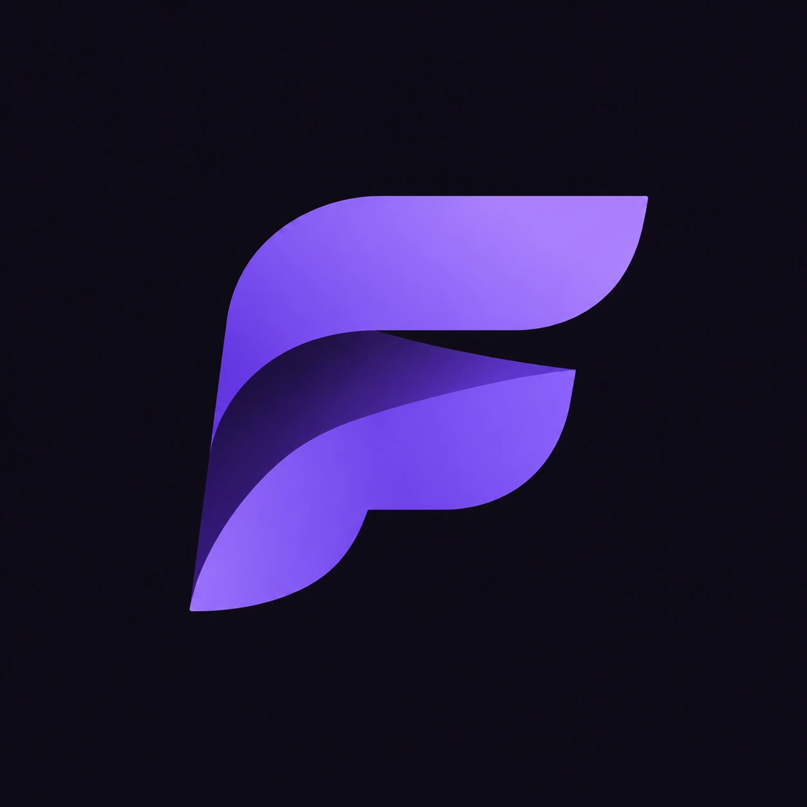
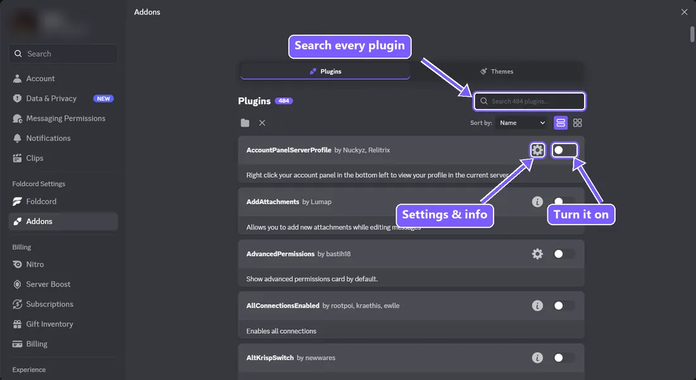
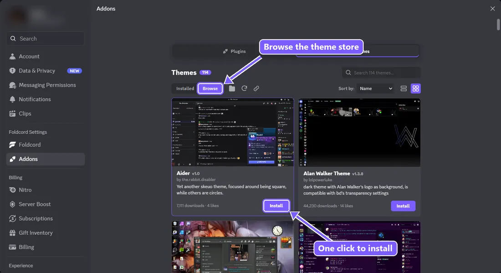

<div align="center">



# Foldcord

**A light, good-looking Discord client mod by xohus & folded.**

Hundreds of plugins, a whole theme store, and a clean UI, without the bloat.

</div>

---

## What you get

- **480+ plugins** from Vencord, Equicord and Endcord, all in one place, with search, sorting and list or grid view.
- **A theme store.** Browse 100+ themes with previews and install one in a click. BetterDiscord `.theme.css` files work too.
- **Fake Profile** by CloudCord: custom avatar, banner, badges, name style, effects and more, synced with CloudCord users.
- **A clean settings layout.** Just two entries in Discord settings: **Foldcord** for your home and settings, and **Addons** for plugins and themes.
- **A quick tour** the first time you open it, so you know where everything is.
- **An animated installer** for Discord, PTB and Canary that can also repair or uninstall.

<div align="center">


</div>

## Install

1. Download `FoldcordInstaller.exe` from [Releases](https://github.com/ffolded/Foldcord/releases).
2. Open it, pick your Discord, and click **Install Foldcord**.
3. Open Discord. The tour shows you around.

Windows may warn you the first time because the installer isn't signed yet. Click **More info → Run anyway**.

To remove Foldcord, open the installer again and click **Uninstall**.

## Build it yourself

You need [Node.js](https://nodejs.org) and [pnpm](https://pnpm.io).

```bash
pnpm install --frozen-lockfile
pnpm build
```

Then build the installer (Windows, no extra tools needed):

```bash
bash installer/build.sh
```

It writes `installer/out/FoldcordInstaller.exe`.

## Credits

Foldcord stands on a lot of great work:

- [Vencord](https://github.com/Vendicated/Vencord) by Vendicated and contributors
- [Equicord](https://github.com/Equicord/Equicord) and its contributors
- [Endcord](https://github.com/Endcord/Endcord) and its contributors, for the extra plugins in `src/endcordplugins/`
- Sincord and Endcord contributors, whose Custom Profile plugin Fake Profile is based on
- [BetterDiscord](https://github.com/BetterDiscord/BetterDiscord), for the addon card styles and the theme store

Every plugin keeps its authors' names. See [`NOTICE.md`](NOTICE.md) for the full list.

## License

- **Code:** GNU GPL v3.0 or later, see [`LICENSE`](LICENSE). BetterDiscord's card styles stay under Apache 2.0, see [`licenses/`](licenses/).
- **Foldcord name, logo and branding, and the CloudCord profile sync service:** © 2026 xohus & folded, see [`FOLDCORD-LICENSE.md`](FOLDCORD-LICENSE.md).

Foldcord isn't affiliated with Discord. Client mods are against Discord's Terms of Service, so use it at your own risk.
